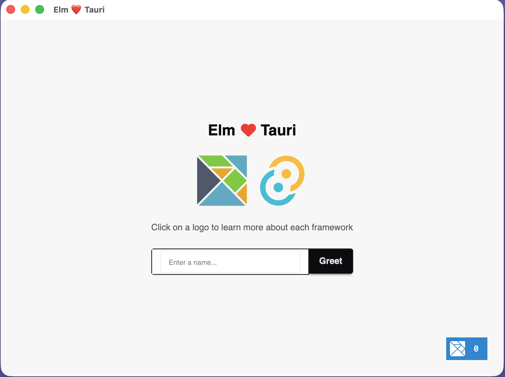

# Tauri + Elm

This template should help get you started developing with Tauri and Elm in Vite.

## Recommended IDE Setup

- [VS Code](https://code.visualstudio.com/) +
  [Elm](https://marketplace.visualstudio.com/items?itemName=Elmtooling.elm-ls-vscode) +
  [Tauri](https://marketplace.visualstudio.com/items?itemName=tauri-apps.tauri-vscode) +
  [rust-analyzer](https://marketplace.visualstudio.com/items?itemName=rust-lang.rust-analyzer)

## Tooling

### Elm

Elm Tooling
[has done its course](https://github.com/elm-tooling/elm-tooling-cli/issues/95).
Nowadays, Elm, and its tools should be installed system wide by the user:

- [Elm](https://guide.elm-lang.org/install/elm.html): install Elm system wide.
- [elm-json](https://github.com/lydell/elm-json): install, upgrade, and
  uninstall Elm dependencies.
- [elm-format](https://github.com/avh4/elm-format): format Elm source code
  according to the official
  [Elm Style Guide](https://elm-lang.org/docs/style-guide).
- [elm-test-rs](https://github.com/mpizenberg/elm-test-rs): write
  [unit](https://en.wikipedia.org/wiki/Unit_testing) and
  [fuzz](https://en.wikipedia.org/wiki/Fuzzing) tests for Elm code.
- [elm-review](https://github.com/jfmengels/node-elm-review): analyze Elm
  projects and find mistakes before your users find them.

### Vite

- [vite-plugin-elm-watch](https://github.com/ryan-haskell/vite-plugin-elm-watch):
  compile an Elm module with hot-module reload.
- [vite-plugin-webfont-dl](https://github.com/feat-agency/vite-plugin-webfont-dl):
  inject [Bunny Fonts](https://fonts.bunny.net/) to improve website's
  performance.
- [vite-plugin-compression](https://github.com/vbenjs/vite-plugin-compression):
  compress resources to improve website's performance.
- [vite-plugin-imagemin](https://github.com/vbenjs/vite-plugin-imagemin):
  compress image assets to improve website's performance.

### Tailwind CSS

This templates uses Tailwind CSS 4 with the `vite`, `typography`, and `daisyUI`
plugins.

#### Daisy UI

[daisyUI](https://daisyui.com/) is a Tailwind CSS classes component library,
aiming to work on all frameworks. The CSS nature of daisyUI makes Elm
integration possible and a breeze to use.

## Contributing

Contributions and constructive criticism are welcome. If you think I'm overdoing
it, feel free to discuss. I strive to improve the template as much as possible.

## Acknowledgments

This templated was inspired by [Elm Land](https://github.com/elm-land/tauri)'s
template.
